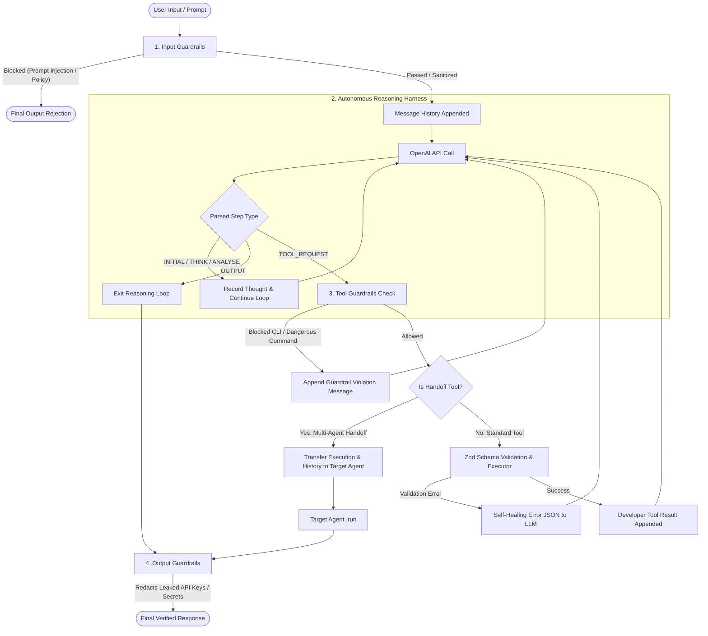

# 🤖 Agent SDK From Scratch

> A lightweight, modular, and fully typed AI Agent SDK built from first principles in TypeScript using the OpenAI API.

---

## 💡 Why This Project Exists

When working with modern AI frameworks like the **OpenAI Agents SDK** or **OpenAI Swarm**, much of the low-level orchestration—such as the reasoning loop, tool parsing, self-healing retries, state delegation, and guardrails—happens under the hood.

This project was built **from scratch** to unpack those internals and understand:
- How autonomous reasoning loops iteratively evaluate user intent and execute actions.
- How multi-agent handoffs pass state, context, and conversation history between specialists.
- How bidirectional guardrails intercept prompts, validate tool parameters, and prevent sensitive data leaks.
- How strict schema validation (via Zod) enables self-healing agent recovery on malformed tool calls.

By building and experimenting with these patterns from scratch, **transitioning to the official OpenAI Agents SDK becomes significantly easier, more intuitive, and transparent.**

---

## 🗺️ Conceptual Mapping: This SDK vs. OpenAI Agents SDK

| Concept | This SDK (`agent-sdk-from-scratch`) | OpenAI Agents SDK / Swarm |
| :--- | :--- | :--- |
| **Agent Definition** | `new Agent({ ... })` or `Agent.builder()` | `Agent(...)` |
| **Instructions** | System prompt combining harness + persona | `instructions: "..."` or dynamic function |
| **Tool Calling** | `defineTool({ name, schema, executor })` with Zod | `function_tool` / python functions with Pydantic |
| **Multi-Agent Handoff** | `createHandoffTool(...)` / `addHandoff(...)` | `handoffs=[agent_b]` |
| **Validation & Safety** | Tri-layer Guardrails (`Input`, `Tool`, `Output`) | Input/Output Guards & Moderation APIs |
| **Observability** | `agent.attachInterceptor(...)` | Agent Runners / Tracing Hooks |
| **Execution Loop** | `await agent.run(query, options)` | `Runner.run(agent, input)` |

---

## 🧠 Core Architecture & Lifecycle Flow

Every call to `agent.run(...)` enters a multi-step reasoning harness that validates policies, computes next actions, and communicates with tools or peer agents.



### The Reasoning Pipeline Steps
The system harness enforces a strict JSON-based ReAct loop:
- **`INITIAL`**: Deconstructs the user query and establishes immediate goals.
- **`THINK`**: Plans sub-tasks, reasoning, and intermediate calculations.
- **`TOOL_REQUEST`**: Requests an action or tool execution with parameters.
- **`ANALYSE`**: Inspects tool results or intermediate computation to ensure accuracy.
- **`OUTPUT`**: Emits the final synthesized answer once all sub-tasks are complete.

---

## ✨ Features

- **Autonomous Reasoning Loop**: Iterative JSON step-by-step reasoning with max loop guard protections.
- **Zod-Powered Type-Safe Tools**: Auto-generated documentation signatures and self-healing validation error payloads returned directly to the agent.
- **Multi-Agent Handoffs**: Peer-to-peer task delegation with seamless context and conversation history inheritance.
- **Tri-Layer Guardrails**:
  - **Input Guardrails**: Prompt injection detection and PII masking (emails, phone numbers).
  - **Tool Guardrails**: Destructive CLI command blocker (`rm -rf`, `DROP TABLE`, format drives).
  - **Output Guardrails**: API key and secret token leak prevention (OpenAI keys, bearer tokens).
- **Fluent Builder API**: Convenient configuration via `Agent.builder()`.
- **Real-Time Observability**: Event stream interceptors to monitor every step, thought, and tool call in real time.

---

## 🚀 Getting Started

### 1. Prerequisites
- Node.js (v18+)
- An OpenAI API Key

### 2. Installation
Clone the repository and install dependencies:
```bash
git clone https://github.com/mohammedsaif001/agent-sdk-from-scratch.git
cd agent-sdk-from-scratch
npm install
```

### 3. Configure Environment Variables
Copy `.env.example` to `.env` and supply your OpenAI API key:
```bash
cp .env.example .env
```
Inside `.env`:
```env
OPENAI_API_KEY=sk-proj-your-actual-api-key-here
```

---

## 💻 How to Use

Here is a complete walkthrough showing how to define tools, assemble specialist agents, configure handoffs, attach interceptors, and call the main function.

```typescript
import 'dotenv/config';
import { Agent, defineTool, defaultGuardrails, z } from './index.js';

// ============================================================================
// 1. Define a Type-Safe Tool with Zod Validation
// ============================================================================
const weatherTool = defineTool({
    name: 'fetchWeatherInfo',
    description: 'Fetches real-time weather data for a specified city name',
    schema: z.object({
        cityName: z.string().min(1, 'City name is required')
    }),
    executor: async ({ cityName }) => {
        // Your API call or business logic here
        return { cityName, weather: 'Sunny, 24°C' };
    }
});

// ============================================================================
// 2. Define Specialist Agents
// ============================================================================
const weatherAgent = new Agent({
    name: 'WeatherAgent',
    instructions: 'You are a meteorological specialist. Provide accurate forecasts using fetchWeatherInfo.',
    tools: [weatherTool],
    inputGuardrails: defaultGuardrails.inputs,
    outputGuardrails: defaultGuardrails.outputs
});

// ============================================================================
// 3. Build Orchestrator / Triage Agent with Handoffs
// ============================================================================
const triageAgent = Agent.builder()
    .setName('TriageAgent')
    .setInstructions(
        'You are the frontline assistant. Understand user needs and delegate to WeatherAgent for any weather queries.'
    )
    .addHandoff(weatherAgent, {
        description: 'Hands off to WeatherAgent when the user asks about weather, forecasts, or temperature.'
    })
    .useDefaultGuardrails()
    .build();

// ============================================================================
// 4. Attach Real-Time Interceptors (Observability / Logging)
// ============================================================================
triageAgent.attachInterceptor((message) => {
    console.log(`[${message.role.toUpperCase()}]: ${message.content}`);
});

// ============================================================================
// 5. Calling the Main Function
// ============================================================================
async function main() {
    console.log('Starting Agent run...\n');
    
    const messages = await triageAgent.run('What is the weather in Tokyo right now?');
    
    // Retrieve the final output message from history
    const finalResponse = messages[messages.length - 1];
    console.log('\nFinal Response:', finalResponse.content);
}

// Execute the main function
main().catch(console.error);
```

---

## 🧪 Running the Demos

The repository includes pre-configured runnable examples:

### Full Multi-Agent & Guardrail Demo
Demonstrates multi-agent handoffs, prompt injection defense, and PII masking:
```bash
npm start
# or
npm run demo
```

### Zod Schema Validation & Self-Healing Demo
Tests tool documentation generation, valid executions, and self-healing error formatting without requiring an active OpenAI key:
```bash
npx tsx src/examples/zod-tools-demo.ts
```

### Type Checking
Validate the TypeScript codebase:
```bash
npm run typecheck
```

---

## 📂 Project Structure

```
agent-sdk-from-scratch/
├── src/
│   ├── core/                  # Core Agent runtime & reasoning harness
│   │   ├── agent.ts           # Autonomous Agent execution engine & loop
│   │   ├── builder.ts         # Fluent AgentBuilder implementation
│   │   ├── parser.ts          # Robust JSON parsing for LLM step payloads
│   │   ├── prompt.ts          # ReAct system harness prompts
│   │   ├── types.ts           # Core interfaces (IAgent, IMessage, AgentOptions)
│   │   └── index.ts           # Module barrel exports
│   ├── tools/                 # Type-safe tool definitions & handoffs
│   │   ├── define-tool.ts     # Zod-backed tool factory with schema reflection
│   │   ├── handoff.ts         # Swarm-inspired agent-to-agent delegation tools
│   │   ├── types.ts           # ITool, ToolExecutor, HandoffOptions
│   │   └── index.ts           # Module barrel exports
│   ├── guardrails/            # Bidirectional security guardrails
│   │   ├── input.ts           # Prompt injection screening & PII masking
│   │   ├── tool.ts            # Destructive CLI command blocker
│   │   ├── output.ts          # Secret / API key leakage protection
│   │   ├── types.ts           # Guardrail types and result schemas
│   │   └── index.ts           # Pre-configured defaultGuardrails
│   ├── examples/              # Runnable demonstrations
│   │   ├── demo.ts            # End-to-end multi-agent handoff & guardrail demo
│   │   └── zod-tools-demo.ts  # Zod schema validation & self-healing demo
│   └── index.ts               # Primary SDK entrypoint
├── .env.example               # Template environment configuration
├── package.json               # Scripts and dependencies
├── tsconfig.json              # TypeScript ESM NodeNext configuration
└── README.md                  # Project documentation
```

---

## 📄 License

ISC License. Built for learning and experimentation.
